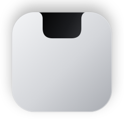

<p align="center">
  
</p>

<h1 align="center">Encoche</h1>

<p align="center">
  L'encoche du MacBook devient une petite Dynamic Island :<br>
  musique, agenda, notifications, presse-papier et Claude, à portée de souris.
</p>

---

Encoche vit dans l'encoche de l'écran. Elle reste noire et discrète pour se fondre avec celle du Mac, et s'ouvre au survol. Sur un écran sans encoche (écran externe), elle en simule une.

## Fonctionnalités

### Dans l'encoche ouverte
- **Accueil** : le morceau en cours (Musique ou Spotify) avec ses commandes, l'agenda du jour, et un champ pour poser une question à Claude.
- **Maison** : une tuile par raccourci du dossier « Encoche » de l'app Raccourcis (allumer une lampe, lancer une scène…). Crée-le dans Raccourcis et ajoutes-y tes actions Maison.
- **Étagère** : les dernières captures d'écran, à glisser où tu veux.
- **Presse-papier** : l'historique de ce que tu as copié. Les mots de passe des gestionnaires sont ignorés.
- **Notifications** : l'historique des notifications, conservé d'un redémarrage à l'autre.
- **Claude** : les sessions Claude Code en cours, et les conversations avec Claude.

### Autour de l'encoche fermée
- **Notifications façon iPhone** : toutes les notifications du Mac, de n'importe quelle app, s'affichent dans l'encoche à la place des bannières de macOS. Elles n'apparaissent que sur l'écran principal.
- **Claude Code** : quand Claude demande une autorisation, tu peux **autoriser ou refuser depuis l'encoche**. Un clic sur une session ramène son terminal ou son app au premier plan.
- **Réunions** : un rappel une minute avant, avec un bouton **Rejoindre** pour Meet, Zoom, Teams, Webex, FaceTime ou Whereby.
- **Volume et luminosité** : les touches du clavier affichent leur niveau dans l'encoche, à la place des indicateurs de macOS.
- **Batterie** : le niveau s'affiche quand tu branches ou débranches le chargeur.
- **Caméra et micro** : un point vert ou orange quand une app les utilise.
- **Musique en cours** : la pochette et un égaliseur de chaque côté de l'encoche.

### Et aussi
- Une encoche sur **chaque écran**.
- Masquée quand une app est **en plein écran**, elle redescend avec la barre de menus quand la souris touche le haut de l'écran.
- **Réglages** (clic droit sur l'encoche → Réglages…) : toutes les options, et l'état de chaque autorisation.
- Option **Liquid Glass** pour l'encoche ouverte, qui suit le réglage de transparence de macOS.
- Très légère : environ 0,1 % de processeur au repos.

## Configuration requise

- macOS 26 ou plus récent
- Xcode 26 et [XcodeGen](https://github.com/yonaskolb/XcodeGen) (`brew install xcodegen`)
- Pour Claude : [Claude Code](https://claude.com/claude-code), connecté à ton abonnement. Encoche passe par la commande `claude`, sans clé d'API.

## Installation

1. Crée une seule fois le certificat de signature local. Il garde la même identité à l'app d'un build à l'autre, et macOS conserve ainsi les autorisations accordées :
   ```bash
   ./scripts/create-signing-cert.sh
   ```
2. Compile et installe dans `/Applications`. Le script lance aussi l'app :
   ```bash
   ./scripts/install.sh
   ```

Au premier lancement, Encoche s'ajoute aux éléments d'ouverture du Mac (désactivable dans les réglages).

### Autorisations

Encoche te guide pour chacune. Leur état est visible dans ses réglages.

| Autorisation | Pour quoi faire |
|---|---|
| **Accès complet au disque** | Lire les notifications des autres apps |
| **Accessibilité** | Les touches volume et luminosité, masquer les bannières de macOS |
| **Calendrier** | L'agenda du jour et les rappels de réunion |
| **Automatisation** (Musique, Spotify) | Afficher et piloter le morceau en cours |

### Claude Code

Dans **Réglages → Claude → Installer les hooks**, Encoche ajoute ses hooks à `~/.claude/settings.json`. Une sauvegarde est faite dans `settings.json.notch-backup`. Les hooks envoient les événements des sessions à Encoche en local (`127.0.0.1:47823`). Rien ne sort du Mac.

## Développement

```bash
./scripts/run.sh          # compile en Debug et relance l'app
```

Le projet Xcode est généré par XcodeGen depuis `project.yml`. Ne modifie pas le `.xcodeproj` : il n'est pas versionné.

L'icône est dessinée par code. Pour la retoucher, modifie le script puis relance-le :

```bash
swift scripts/make-icon.swift
```

### Organisation

| Dossier | Contenu |
|---|---|
| `Notch/App` | Lancement, fenêtres de l'encoche, écrans, plein écran, réglages |
| `Notch/UI` | Vue de l'encoche, onglets, forme |
| `Notch/Music` | Musique et Spotify |
| `Notch/Calendar` | Agenda et rappels de réunion |
| `Notch/Clipboard` | Historique du presse-papier |
| `Notch/Home` | Onglet Maison (raccourcis) |
| `Notch/Shelf` | Étagère et captures d'écran |
| `Notch/Notifications` | Notifications macOS, bannières, historique |
| `Notch/Claude` | Questions à Claude, suivi des sessions Claude Code, hooks |
| `Notch/Volume`, `Notch/HUD` | Volume, luminosité, batterie, caméra et micro |
| `Notch/Settings` | Fenêtre de réglages |

Le code s'appelle encore `Notch` en interne (dossiers, cibles, identifiant `com.guillaumeprost.notch`). Garder l'identifiant permet à macOS de conserver les autorisations déjà accordées.
